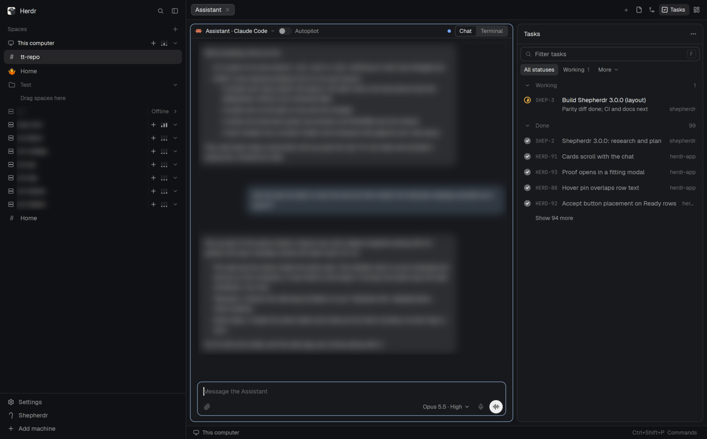

# Shepherdr

Mission control for your coding agents inside Herdr: your spaces in a sidebar, each with its own Assistant you talk to
as a chat, and a Tasks panel on the right that shows which task needs you, which is ready and which is still working.
You tell the Assistant what needs doing; it turns it into tasks, each run by its own agent in its own git worktree,
and asks you on a card when it needs a decision. Shepherdr 3.1.9, for herdr-app 0.1.12 and herdr-core 0.1.17 or newer.

## What you see

Left to right, on the theme's `canvas` background, no title bar:

- **Sidebar** (391px, 44–480, the theme's `chrome`): Herdr's brand row on top (46px, the shipped `workspace-chrome`).
  Then Spaces, grouped by machine ("This computer" first, then each connected machine with a load meter), Pinned and
  sections of your own you can drag spaces into; each space is `#` or an emoji, bold when its Assistant has something
  new, with a red count of what needs you and a green count of what's Ready. At the foot (97px): Settings (Herdr's
  own), Shepherdr (its settings) and Add machine.
- **Tab bar** (42px): the space's tabs, then on the right `+`, the side panels' buttons (Files, Changes, Tasks with its
  red/green counts, Artifacts) and the layout switcher.
- **Main** (the active tab): each pane has a 30px header (`pane-chat`): an Assistant's space name and folder
  ("shop ~"), an Autopilot switch on an Assistant, and Chat | Terminal. Chat shows the agent's conversation as
  bubbles with question, permission and secret cards in the timeline, a box with attach, model choice, dictation and
  Send (or Call when the box is empty). Panes are 10px rounded with a 1px border, accent when focused, 8px apart.
- **Side panel** (510px, 280–900): one of Files, Changes, Tasks or Artifacts. Tasks is one list grouped by status
  (Needs you, Ready, Merging, Working, Queued, Scheduled, To do, Done), a filter box and status chips; a working
  task's dot fills like a pie with its % done, and its second line is what its agent is doing (at most 40 characters).
  A task opens in place: a 127px head (‹ Tasks, base branch, Pin, Accept; the task and its status line; the switcher)
  over its Chat, Terminal, Files, Changes, Pull request and Browser. Artifacts lists agents' reports and draft
  screens; one opens in place under a 42px head.
- **Status bar** (28px): the machine, and Ctrl+Shift+P Commands.
- Floating: a call bar at the top center while a voice call runs elsewhere, toasts at the bottom right.

## How it behaves

- Agent status shows on the task dot and in the chat: working (amber pie with % and minutes left once real), needs
  you (one red dot: a question, permission or plan card waits), ready (green: its agent said it's finished, with a
  summary; Accept merges it and marks it done), done (grey check), queued and to do (outlines).
- A question or permission prompt from Claude Code or Codex arrives as a card in the chat (the hooks the installer
  adds); you answer with a click, also from the Assistant's chat. Secrets are typed into a masked card and never
  shown.
- Ctrl+K opens Jump (spaces, tasks, artifacts), Ctrl+Shift+? the keys list, Ctrl+Shift+D dictates, Ctrl+Shift+Space
  calls the Assistant, Ctrl+F finds in the chat. Alt+1…9 pick a tab, Alt+Up/Down a space, Alt+Enter splits.
- Shepherdr settings (the sidebar foot): Agents, Tasks, Autopilot, Notify, Secrets, Machines, Window and Web. Window
  holds the look switches and the add-on switches: Artifacts, Voice and dictation, Reactions, Task browser, Autopilot,
  Other machines and Web can be turned off; the rest is always on in 3.1.9. Web shows the web app's link and Serve
  from, the machine that serves it.
- The web app (`https://<this machine>/shepherdr/`, your tailnet only): the same spaces, Assistants, tasks, cards,
  artifacts and settings on a phone, a tablet or another browser, on the same data.

## Built from

- `layouts/shepherdr.json`: root row → `sidebar` column (`brand` workspace-chrome, `spaces` spaces-chat,
  `sidebar-footer` workspace-chrome-shepherdr `{footer: true}`) and `work` column (`tabs` tabs-tasks, `work-body` row
  of `main` `{tab: "active"}` with the pane-chat header and `panel` column → `panel-body` stack of files, changes,
  `tasks` stack (`tasks-list` tasks; `tasks-thread`: chat `{panel, head}`, then a stack of chat `{panel}`, a terminal
  block, task-files, task-changes, task-pr, task-browser) and `artifacts` stack; `status` workspace-status-chat).
  Floating `chat-call` (top, center) and `toasts` (bottom, end).
- 29 mods in `mods/` (lib/addons.json lists them by add-on), plus Herdr's shipped `files`, `changes` and
  `workspace-chrome`. Shared modules have one source in `lib/` and are copied into each mod (`bin/sync-shared`).
- Programs: `herdr-task` (mods/tasks/bin, Python: the tasks and their scheduler), `herdr-artifact`
  (mods/artifacts/bin), `herdr-secret` and `herdr-browser` (bin/), linked into `~/.local/bin`; the role instructions
  in `~/.config/herdr-core/templates` (assistant.md, worker.md, reviewer.md); `keys.json`.
- The web app: `web/` (React), served with the background work by one always-on service (`service/`, Bun on
  `127.0.0.1:7788`, systemd or launchd) and shared with `tailscale serve`; `core/` holds the logic it shares with the
  mods. `./install.sh --web` installs it alone.
- The mods run programs (`exec`: herdr-task, git, gh, hc, agent-browser, bun), read files outside their
  folders (`~/.herdr`, the agents' logs, `~/.config/herdr-core/templates`) and reach the network through those
  programs (GitHub, ElevenLabs for voice and dictation).

## Watch out

- Install it with `./install.sh` from this repo, not by copying the folders: the helpers in `bin/`, `lib/`, the
  templates and the hooks are outside `mods/`, and the installer links them, merges `keys.json` (asking before it
  replaces a key you use), backs up what it replaces and records what it put there (`shepherdr uninstall` takes it
  back out). `./install.sh --dry-run` shows everything first.
- Mod names are fixed (`chat`, `tasks`, …): their state in `data/<mod>` and pane names follow them. The installer
  refuses a folder by the same name that isn't Shepherdr's.
- Needs python3 3.8+ and git; bun and Tailscale for the web app; gh for pull requests, agent-browser 0.41.1 and node
  for the task browser, bun and pw-record for voice and dictation,
  an ElevenLabs key for calls and dictation. Claude Code or Codex as the agents.
- Two blocks are rewritten while you use it (`tasks-thread-term` points at the shown task's terminal,
  `artifacts-view-body` at the opened artifact): ship them blank.

## Done when

- `shepherdr doctor` says "whole", and `bin/sync-shared --check` passes.
- Ctrl+Shift+L shows the Shepherdr layout: the sidebar lists your spaces by machine, the tab bar has Tasks and
  Artifacts, the status bar shows the machine.
- A new space's Assistant opens as a chat; asking it for a task adds a row under Working in Tasks with a pie dot,
  and the task's Ready row has Accept.
- An agent's permission prompt shows as a card in its chat.
- Turning Reactions off in Shepherdr settings › Window hides the smiley on messages; turning it on brings it back.
